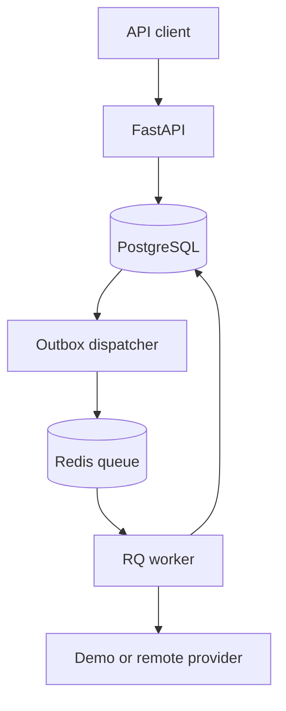

# AI TaskHub

**Python backend engineering for AI workloads.**

Submit text processing jobs, get an immediate `202 Accepted`, and retrieve validated results when a worker finishes. Built to demonstrate authentication, relational data modeling, background processing, concurrency, and LLM integration in one focused service.

`Python 3.12+` · `FastAPI` · `PostgreSQL` · `SQLAlchemy` · `Redis / RQ` · `Docker` · `pytest`

> Portfolio project, not a hosted commercial service. Demo mode runs without a model-provider API key. Remote mode supports a configurable OpenAI-compatible Chat Completions endpoint.

## Why this project

A slow model call should not hold an HTTP request open. Retrying a request should not create duplicate work. A Redis outage should not erase an accepted request. AI TaskHub separates request acceptance, durable storage, delivery, and processing to address those problems.

## What it does

| Capability | Implementation |
|---|---|
| Background processing | Separate API, dispatcher, and RQ worker processes |
| Durable acceptance | Database commit before a job becomes eligible for dispatch |
| Authentication | Random API keys, SHA-256 digests stored in the database |
| Access boundaries | Each key can list and read only its own jobs |
| Request deduplication | Owner-scoped unique idempotency key and payload fingerprint |
| Duplicate delivery | Atomic database transition from queued to running |
| Provider resilience | Three attempts for timeouts, transport failures, 429, and 5xx; exponential delay and jitter |
| Validated outputs | Pydantic summary and extraction schemas |
| Diagnostics | Request IDs, duration logs, liveness and database readiness endpoints |
| Reproducible setup | Pinned dependencies, Compose, tests, CI configuration |

## Architecture



Job lifecycle: `queued → running → succeeded / failed`.

The database job row acts as a minimal outbox. The dispatcher sends undispatched jobs to Redis and records delivery afterward. A crash between those steps can produce a duplicate delivery; the worker's atomic claim prevents duplicate processing during normal execution. Delivery may repeat; this is not an exactly-once guarantee or a loss-proof delivery guarantee across infrastructure failures. See the recovery limits below.

## Quick start with Docker

Install Docker Desktop with Compose. From this directory:

```bash
docker compose up --build -d
docker compose exec api python -m app.cli create-key --name portfolio-demo
```

Copy the generated key; it is printed only at creation. Open **http://localhost:8000/docs**, select **Authorize**, and enter it.

Submit a job:

```bash
curl -X POST http://localhost:8000/v1/jobs \
  -H 'Content-Type: application/json' \
  -H 'X-API-Key: YOUR_GENERATED_KEY' \
  -H 'Idempotency-Key: demo-summary-001' \
  -d '{"task":"summarize","text":"Our service processes requests in the background. The API returns immediately. Workers save the results."}'
```

Then retrieve it using the returned `id`:

```bash
curl http://localhost:8000/v1/jobs/JOB_ID -H 'X-API-Key: YOUR_GENERATED_KEY'
```

Example completed result excerpt:

```json
{
  "task": "summarize",
  "status": "succeeded",
  "result": {
    "summary": "Our service processes requests in the background. The API returns immediately.",
    "provider": "demo"
  }
}
```

Use `"task": "extract"` to return `emails` and `keywords` instead. Demo summaries select the first two sentences; demo extraction uses regular expressions and word frequencies. **Demo mode does not call an LLM.**

Windows PowerShell users can use Swagger UI or `curl.exe`; the multiline curl example above uses Bash syntax.

Stop services with `docker compose down`. Named volumes retain data. PostgreSQL and Redis have no published host ports; the API binds to localhost.

## Local development

Python 3.12 or 3.13, plus Redis (Docker recommended on Windows):

```bash
python -m venv .venv
# Windows PowerShell: .venv\Scripts\Activate.ps1
# macOS/Linux: source .venv/bin/activate
python -m pip install -r requirements.lock -r requirements-dev.lock
python -m pip install --no-deps -e .
python -m app.cli init-db
python -m app.cli create-key --name local-demo
uvicorn app.main:app --reload
```

The local default uses SQLite. In separate terminals with the same environment, run:

```bash
python -m app.dispatcher
rq worker --url redis://localhost:6379/0 --serializer json ai-tasks
```

Use Docker for the worker on Windows. Without Redis or a running dispatcher/worker, jobs remain queued. Tests need neither an external Redis server nor an API key.

## Enable a real model

Copy `.env.example` to `.env` and configure:

```dotenv
AI_PROVIDER=remote
LLM_BASE_URL=https://api.openai.com/v1
LLM_MODEL=gpt-4.1-mini
LLM_API_KEY=your-own-key
```

Restart local processes, or run `docker compose up -d --force-recreate` for Compose. Providers must support `/chat/completions`, JSON object response format, and the configured model. Select a model available in your account; no cross-provider compatibility is implied. Remote calls send submitted text to that provider and may incur charges. The adapter has mocked HTTP tests; no paid inference was run during creation.

## API reference

| Method | Path | Purpose |
|---|---|---|
| POST | `/v1/jobs` | Accept summarize or extract job; returns 202 |
| GET | `/v1/jobs?limit=20&offset=0` | Paginated jobs for the current key |
| GET | `/v1/jobs/{id}` | Status and result; 404 for another key's job |
| GET | `/health/live` | Process liveness |
| GET | `/health/ready` | Database connectivity, not queue/worker readiness |
| GET | `/docs` | Interactive OpenAPI documentation |

`X-API-Key` is required for job endpoints. `Idempotency-Key` is optional on submission (1–128 characters). Reusing it with the same payload returns the original job; different content returns 409. Input is limited to 20,000 characters; empty and whitespace-only text are rejected. Raw input and key digests are omitted from API responses.

## Verification

```bash
ruff check .
ruff format --check .
pytest --cov=app --cov-report=term-missing --cov-fail-under=80
```

Creation-time result: **20 tests passed, 86% statement coverage on Python 3.12**. Tests cover tenant isolation, validation, concurrent idempotency, atomic claiming, queue outage recovery, actual RQ execution with fakeredis, transient HTTP retries, permanent errors, and invalid model output. One dependency deprecation warning is present. CI is configured for Python 3.12 and 3.13; remote CI results are not claimed.

Docker/PostgreSQL execution was not available in the authoring environment. The local suite exercises SQLite and simulated Redis; validate Compose before deploying.

## Scope and tradeoffs

- No claim of production readiness, measured throughput, or commercial usage.
- A worker killed after claiming a job can leave it `running`. A Redis loss after dispatch can strand a queued job. An operator must investigate; automated leases/reconciliation are future work. Never blindly retry an in-flight model request, which may incur duplicate costs.
- Provider retries are bounded within one worker execution. `attempts` counts worker claims, not HTTP attempts. Terminal failed jobs require a new submission with a new idempotency key.
- One dispatcher is intended; multiple dispatchers can enqueue duplicates. Worker claims protect processing but do not remove queue overhead.
- `create_all` initializes a fresh schema; versioned migrations are not implemented.
- API keys represent service clients, not full user accounts. Add key revocation, quotas, rate limiting, TLS termination, monitoring, retention policies, and database migrations before exposing publicly.
- Text is persisted in the database. Use synthetic data for demonstrations and keep `.env` and real customer information out of source control.

See [design decisions](docs/architecture.md) and the [interview walkthrough](docs/interview-guide.md).

## Layout

| Path | Responsibility |
|---|---|
| `app/main.py` | HTTP routes, authentication, request tracing |
| `app/store.py` | Schema, ownership filters, atomic state changes |
| `app/dispatcher.py` | Database-to-Redis delivery |
| `app/worker.py` | Job execution and sanitized failure handling |
| `app/providers.py` | Demo processing and remote LLM adapter |
| `tests/` | API, concurrency, queue delivery, provider tests |

MIT licensed. Created as a portfolio learning project with AI assistance; review and understand the implementation before presenting it in interviews.
